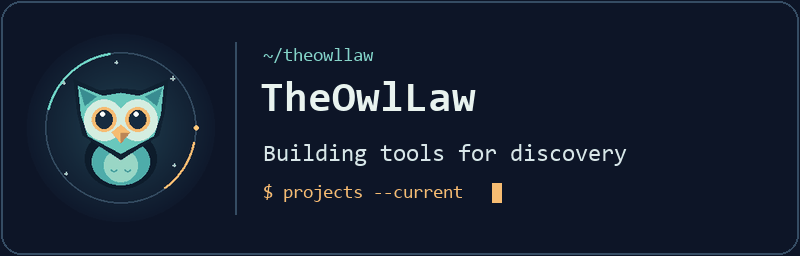

<picture>
  <source media="(prefers-reduced-motion: reduce)" srcset="assets/profile-header.png">
  
</picture>

I build apps that help people find and compare things. Right now that means local businesses in Winnipeg and watches you could see yourself wearing.

## On my workbench

**Mioth** helps people search for Winnipeg businesses and compare their services side by side. I'm building the directory around details sourced from the businesses' own websites.

**Watch discovery app** starts with the look of a watch. Explore similar styles, find lower-priced alternatives, and save favorites to a private collection.

## Public experiment

**[Crisp chat widget demo](https://github.com/TheOwlLaw/n8nwebsite)** is a small static site I used to explore adding a chat widget to a plain HTML page. [Open the demo](https://theowllaw.github.io/n8nwebsite/).

[Say hello](mailto:armaanthind11@gmail.com) · [Still header](assets/profile-header.png)
